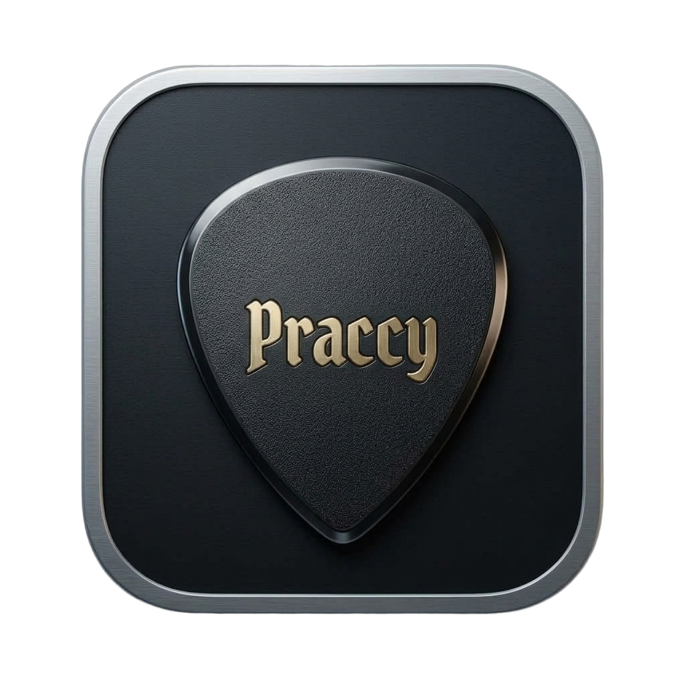

# Praccy

<div align="center">



### Ultra-lightweight ASIO VST3 & CLAP host for instant instrument practice, live jamming, and universal DAW preset exchange.

[](https://github.com/BartekStaniak/Praccy/releases)
[](https://github.com/BartekStaniak/Praccy)
[](https://github.com/BartekStaniak/Praccy)
[](https://github.com/BartekStaniak/Praccy)
[](https://en.wikipedia.org/wiki/C%2B%2B20)
[](LICENSE)

</div>

> Cold boots in under 500 ms, streams directly to your audio interface via ASIO with zero added buffer latency, organizes serial/parallel plugin rigs, and exchanges signal chains seamlessly across Cockos Reaper, Ableton Live, Bitwig / Studio One (DAWproject 1.0), and native Steinberg VST3 presets.

---

## Overview

Full digital audio workstations like REAPER, Ableton Live, Cubase, or Studio One are indispensable for track production, multitrack recording, and mixing. But when you just want to pick up your guitar, bass, or synth and practice for 15 minutes, opening a full DAW introduces excessive friction:
- **Lengthy load times:** Waiting 20–45 seconds while hundreds of unused plugins, templates, and project media scan.
- **Resource bloat:** Heavy background memory usage, background disk indexing, and complex routing matrices.
- **Latency overhead:** Added buffer queues and driver bridging layers that dull instrument responsiveness.
- **Rigid lock-in:** Preset chains built in one DAW cannot easily be auditioned or loaded in another.

**Praccy** was built from the ground up to solve this exact problem. It is an ultra-lean, native C++20 ASIO host designed specifically for practicing, noodling, and live pedalboard-style jamming. It bypasses all unnecessary DAW layers, communicates directly with your audio interface via native ASIO, renders a high-framerate hardware-accelerated interface via DirectX 11 and Dear ImGui, and gets you playing in seconds.

With **Version 2.4**, Praccy bridges the gap between practice and professional studio production through the **Universal DAW Interop Matrix** and the **Musician Velocity Engine**.

---

## What's New in Version 2.4

### 🌐 Universal DAW Interop Matrix (Stage 2)
Exchange your complete plugin rigs and presets bidirectionally with the leading digital audio workstations:
- **Cockos Reaper (`.RfxChain`)**: Full S-expression import and export with 64-bit `PINMAP` routing matrix decoding (`3 3` $\rightarrow$ Branch A, `12 12` $\rightarrow$ Branch B, unmapped $\rightarrow$ Serial slot) and VST3 chunk envelope handling.
- **Ableton Live (`.adg` Audio Effect Rack)**: In-process RFC 1952 Gzip decompression/compression and XML parsing. Automatically flattens complex nested racks and reduces multi-branch splits to Branch A/B.
- **Open DAWproject 1.0 (`.dawproject`)**: Strict compliance with the open standard container specification (ZIP container, root `manifest.xml`, `project.xml`, and raw plugin state binary streams). Compatible with **Bitwig Studio**, **PreSonus Studio One**, and open DAW tooling.
- **Steinberg VST3 (`.vstpreset`)**: Single-slot RIFF container export and import for hot-swapping individual plugin presets.
- **Centralized Drag-and-Drop Router (`WM_DROPFILES`)**: Drag `.RfxChain`, `.adg`, `.dawproject`, `.vstpreset`, audio tracks, or `.praccy` scenes straight into the rack from Windows Explorer.
- **Multi-Tier `PluginResolver`**: Intelligently resolves foreign DAW plugin references across 4 stages: Canonical 32-char GUID $\rightarrow$ Bundle Filename $\rightarrow$ Normalized Library Name $\rightarrow$ `MissingPluginPlaceholder`.
- **`MissingPluginPlaceholder` & Host Safety**: Missing plugins degrade gracefully into bit-exact dry audio pass-through with distinct visual alert badges, while Structured Exception Handling (`__try` / `__except`) sandboxes corrupt binary chunks.

### ⚡ Musician Velocity & Real-Time Engine (Stage 1)
- **Parallel Delay Compensation (PDC)**: Phase-coherent 16,384-sample circular delay line compensating branch latency deltas ($\Delta L = |L_A - L_B|$) with a 64-sample dynamic equal-power micro-crossfade to eliminate comb filtering and clicks.
- **Retroactive Riff Recording (`Ctrl+Shift+R`)**: Rolling atomic audio buffer configurable from 1 to 10 minutes. Latch and export your spontaneous riffs to 24-bit WAV in `%USERPROFILE%\Documents\Praccy\Riffs\` without missing a note.
- **Transactional Undo / Redo (`Ctrl+Z` / `Ctrl+Y`)**: 64-level history stack with 400ms continuous parameter coalescing and zero-leak state rollback.
- **Instant A/B Tone Snapshot (`[A | B]`)**: One-click tone comparison switching between two scene snapshots with a 10ms click-free crossfade.
- **Front-Panel Mini-Knob Macro Engine**: 4 tactile mini-knobs per card with fuzzy regex **Heuristic Discovery** (`Gain/Drive`, `Tone/EQ`, `Volume/Master`, `Mix/DryWet`). Right-click any macro to reassign.
- **Horizontal Rack Drag-and-Drop**: Reorder pedalboard slots with live ghost previews and atomic SPSC audio-thread swap crossfades.
- **Global Key & MIDI Map Mode (`Ctrl+K` / `Ctrl+M`)**: Ableton-style click-to-learn hardware mapping, strictly guarded with `!WantTextInput` so search boxes never trigger commands.
- **Spotlight Command Palette Virtualization**: Search 1,500+ plugins at a locked 144 FPS powered by `ImGuiListClipper`, featuring `All`, `Favorites`, and `Recents` scope pills.
- **DIN IEC 60268-10 PPM Ballistic Meters**: Multi-segment gradient level meters with exponential decay and audio-reactive cable glow.
- **WCAG 2.1 AA Production Themes**: Four hand-crafted color palettes (**Obsidian Studio**, **Cyber / Midnight**, **Nordic Slate**, and **Vintage Console**) with 100% design token purity.

---

## Signal Flow Architecture

```
[ ASIO Audio Input (Hardware) ]
               │
      [ Input Channel Router ] (Stereo / Left Mono / Right Mono)
               │
      [ Practice Tuner Tap ] ────────► [ YIN Strobe Tuner (Worker Thread) ]
               │
+──────────────▼─────────────────────────────────────────────────────────────+
│                     Praccy Audio Processing Graph                          │
│                                                                            │
│  [ Slot 1: Serial Plugin ] (e.g. Compressor / Overdrive)                   │
│               │                                                            │
│        [ Branch Splitter ]                                                 │
│        ┌──────┴──────┐                                                     │
│        │             │                                                     │
│  [ Branch A ]   [ Branch B ]  (e.g. Dual Amp Sim / Wet-Dry Parallel FX)   │
│  - Amp Clean    - Amp High-Gain                                            │
│  - Pan L / Gain - Pan R / Phase Inv                                        │
│  - PDC Delay L_A- PDC Delay L_B (16k Phase-Coherent Delay Compensation)    │
│        │             │                                                     │
│        └──────┬──────┘                                                     │
│         [ Branch Summer ]                                                  │
│               │                                                            │
│  [ Slot 3: Serial Plugin ] (e.g. Stereo Delay / Ambient Reverb)            │
+────────────────────────────────────────────────────────────────────────────+
               │
      [ Master Safety Limiter ] (Smooth tanh soft-saturation ceiling)
               │
[ ASIO Audio Output (Hardware) ]
```

---

## Keyboard Shortcuts & Workflow Reference

| Shortcut | Context | Action |
| :--- | :--- | :--- |
| `Ctrl+Z` | Global | Undo rack state change (64 levels) |
| `Ctrl+Y` | Global | Redo rack state change |
| `Ctrl+Shift+R` | Global | **Save Last Riff** (exports rolling buffer to 24-bit WAV) |
| `Ctrl+M` | Global | Toggle Global **MIDI Map Mode** (pulsating violet border) |
| `Ctrl+K` | Global | Toggle Global **Computer Key Map Mode** |
| `Ctrl+E` | Global | Open **Export Chain as DAW Preset...** dialog |
| `Q` | Focused Card | Open pre-filtered Spotlight Command Palette |
| `[` / `]` | Focused Card | Hot-swap to previous / next preset with 10ms crossfade |
| `0` | Focused Card | Toggle plugin bypass |
| `Tab` | Spotlight | Cycle scope pills: `All` $\leftrightarrow$ `Favorites` $\leftrightarrow$ `Recents` |
| `F` | Spotlight | Toggle Favorite star (`★`) on hovered plugin |
| **Drag & Drop** | Rack Faceplate | Drag `.RfxChain`, `.adg`, `.dawproject`, or `.vstpreset` to load |
| **Drag Card** | Rack Faceplate | Horizontal drag-and-drop to reorder signal chain |

---

## Quickstart Guide

1. **Launch Praccy**: Run `Praccy.exe`.
2. **Select Audio Device**: In the top navigation bar, choose your ASIO audio interface (Focusrite Scarlett, Universal Audio Apollo, RME, MOTU, FL Studio ASIO, etc.).
3. **Configure Input**: Set your instrument input channel:
   - **Stereo**: Both channels 1 & 2.
   - **Left Mono (Ch 1)**: Standard single-cable guitar / bass input into input 1.
   - **Right Mono (Ch 2)**: Input 2.
4. **Scan Plugins**: Click **Plugins...** in the top bar to scan your VST3 and CLAP library, or use **Search Paths...** to add custom plugin folders.
5. **Build Your Rig**: Click **+ Add Plugin** on the serial rack or inside parallel branches. Use `[|| Split]` to create parallel dual-amp or wet/dry configurations.
6. **Tune & Play**: The chromatic strobe tuner is always active at the top of your rack.
7. **Export to DAW**: Click **Scene $\rightarrow$ Export Chain as DAW Preset...** to bring your tone into Reaper, Ableton Live, Bitwig, or Studio One.

---

## Building From Source

Praccy is written in modern **C++20** and builds cleanly using CMake on Windows with either MSVC (Visual Studio 2022) or MinGW-w64 (`w64devkit` / GCC 13+).

### Prerequisites
- Windows 10 / 11 (64-bit)
- CMake 3.25 or newer
- **MSVC** (Visual Studio 2022 C++ Build Tools v143+) OR **MinGW-w64** (GCC 13+)
- DirectX 11 runtime (standard in Windows 10/11)
- An ASIO-compatible audio interface or driver

### 1. Build with Visual Studio (MSVC)

```powershell
# Clone the repository
git clone https://github.com/BartekStaniak/Praccy.git
cd Praccy

# Configure and generate build files
cmake -B build -G "Visual Studio 17 2022" -A x64

# Compile Release binary
cmake --build build --config Release
```

The resulting executable will be generated at `build/Release/Praccy.exe`.

### 2. Build with MinGW / w64devkit

```powershell
# Configure Ninja / Makefiles
cmake -B build -G "Ninja" -DCMAKE_BUILD_TYPE=Release

# Compile
cmake --build build
```

The resulting executable will be generated at `build/Praccy.exe`.

---

## Running Automated Verification Gates

Praccy enforces strict real-time safety, SecOps fuzzing, and cross-DAW roundtrip parity gates:

```powershell
# 1. Run complete CTest regression suite (13 test targets)
ctest --test-dir build -C Release --output-on-failure

# 2. Gate 2.1: Interop SecOps Fuzzing (10,000 malformed inputs)
.\build\test_interop_fuzz.exe

# 3. Gate 2.2: Cross-DAW Roundtrip Parity Suite (Reaper, Ableton, DAWproject, VST3)
.\build\test_interop_roundtrip.exe --all

# 4. Gate 1.4: Design Token Purity & WCAG 2.1 AA Contrast Audits
py scripts/check_hardcoded_colors.py
py scripts/wcag_audit.py
```

---

## Tech Stack & Standards

- **Language:** C++20 (MSVC / GCC)
- **Audio API:** Steinberg ASIO SDK
- **Plugin Standards:** Steinberg VST3 SDK & CLAP (Clever Audio Plugin) API
- **DAW Formats:** Cockos Reaper `.RfxChain`, Ableton Live `.adg`, Open DAWproject 1.0 `.dawproject`, Steinberg `.vstpreset`
- **Archiving & SecOps:** In-process RFC 1952 Gzip & Zip Slip resistant miniz wrapper
- **Rendering & GUI:** DirectX 11 & [Dear ImGui](https://github.com/ocornut/imgui) (Docking branch)
- **Pitch Detection:** Custom YIN autocorrelation algorithm
- **Concurrency:** Moody Camel ReaderWriterQueue (Lock-free SPSC) & Windows MMCSS Real-Time Audio Scheduling

---

## Author

Developed with care by **Bartek Staniak**  
GitHub: [@BartekStaniak](https://github.com/BartekStaniak)

---

## License

This project is licensed under the **MIT License** — see the [LICENSE](LICENSE) file for details.  
*VST is a registered trademark of Steinberg Media Technologies GmbH. All other product and company names are trademarks or registered trademarks of their respective holders.*
